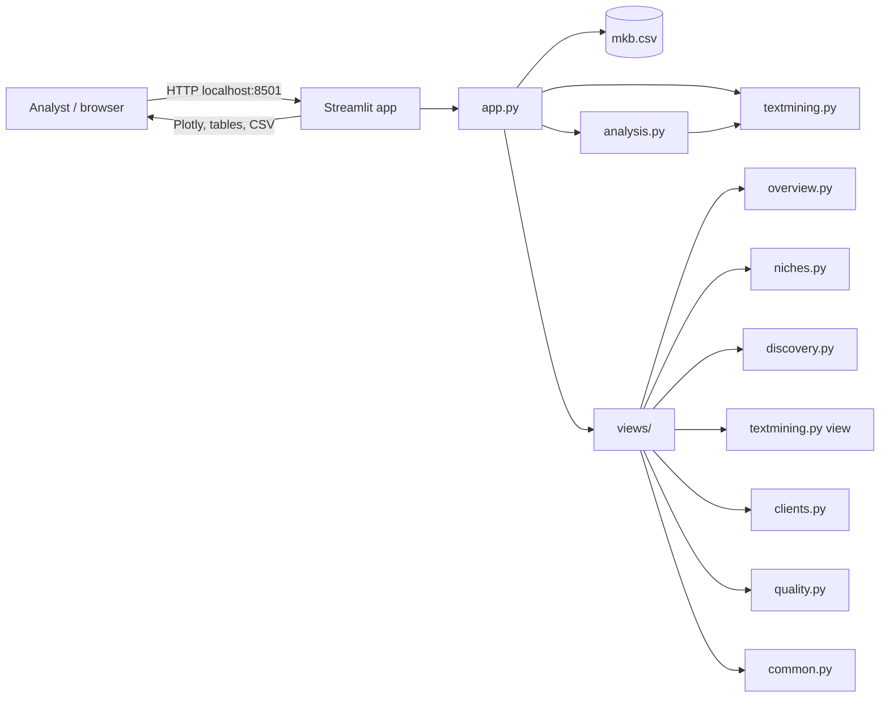
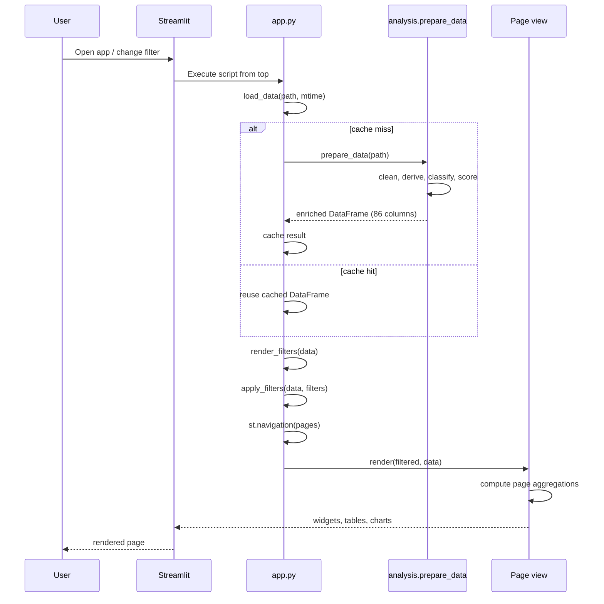

# Architecture — Upwork FinTech / Finance / Crypto Market Intelligence

This document describes how the dashboard is built, how data moves through it, how the analytical scores are defined, and how to extend or maintain the project.

For setup, usage, and the current snapshot's analytical findings, see [`README.md`](README.md).

## 1. Purpose and scope

The project is a local, single-process Streamlit application that:

1. Loads one CSV snapshot of Upwork job ads.
2. Cleans and de-duplicates the data.
3. Enriches each job with rule-based niche classification, problem extraction, economics, dates, and scores.
4. Applies global sidebar filters.
5. Renders six analytical pages.
6. Provides a filtered CSV export for offline work.

It does **not**:

- Scrape Upwork at runtime.
- Persist analytical outputs to a database.
- Train a predictive model or use an LLM.
- Claim that the snapshot represents the whole market.
- Make application or pricing decisions automatically.

The design favours explainability, low operational cost, and direct inspection of evidence over model sophistication.

## 2. System context



There are no external services, secrets, background workers, message queues, or scheduled jobs. The only network dependency is the browser loading the local Streamlit server; job links point outward to Upwork.

## 3. Runtime lifecycle



Important consequences:

- Every widget interaction reruns the whole `app.py` script.
- The only expensive operation that is cached is `prepare_data`.
- Page-level aggregations and text-mining term spaces are recomputed on each rerun.
- Session state belongs to one browser session; it is not shared across users.
- The current snapshot is small, so recomputation is acceptable. A larger dataset would need precomputation or finer caching.

## 4. File and module map

| Path | Responsibility |
| --- | --- |
| `app.py` | Entrypoint; page config; cached data load; global filters; page registry and navigation. |
| `analysis.py` | Data loading, feature engineering, taxonomy, classification, scoring, aggregations, clustering, quality metrics. |
| `textmining.py` | Text cleaning, tokenisation, term space, phrase statistics, niche comparison, co-occurrence, trends, context, word clouds. |
| `views/common.py` | Shared design tokens, Plotly theme, KPI cards, notes, money/percent formatting, job and styled tables, sparklines. |
| `views/overview.py` | Market Overview page. |
| `views/niches.py` | Niche Intelligence page. |
| `views/discovery.py` | Project & Service Discovery page. |
| `views/textmining.py` | Text Mining & Keyword Intelligence page. |
| `views/clients.py` | Clients & Competition page. |
| `views/quality.py` | Data Quality & Collection Coverage page. |
| `mkb.csv` | Raw 93-row input snapshot. |
| `requirements.txt` | Runtime dependencies with minimum versions. |
| `.streamlit/config.toml` | Light theme, colours, font, usage-statistics opt-out. |
| `readme1.md` | Original main-dashboard product brief. |
| `readme2.md` | Original text-mining product brief. |

The codebase is intentionally small: roughly 3,900 lines across the app, analytics, text-mining, and view modules.

## 5. Data contract

### 5.1 Input

`analysis.prepare_data(path)` reads a UTF-8 CSV (BOM tolerated) and expects at least these fields:

| Field | Role |
| --- | --- |
| `job_id` | Unique identifier; rows without it are dropped. |
| `title`, `description`, `skills` | Text and skill signals for classification and mining. |
| `url` | Link to the source job ad. |
| `scraped_at` | Reference time for relative-date estimation and `days_old`. |
| `published_at`, `created_at`, `posted_relative` | Date provenance, in priority order. |
| `job_type`, `hourly_min`, `hourly_max`, `fixed_budget` | Contract and economics. |
| `duration`, `workload`, `proposals`, `experience_level` | Contract structure and competition. |
| `client_country`, `client_payment_verified`, `client_total_spent`, `client_reviews`, `client_rating` | Client quality. |
| `search_query`, `search_label`, `search_filters`, `search_page` | Collection provenance. |

Columns are stripped of whitespace. `job_id` is converted to string and de-duplicated, keeping the first row. Numeric fields are coerced with `pd.to_numeric(errors="coerce")`.

### 5.2 Output

`prepare_data` returns one row per unique job and 86 columns:

| Group | Examples |
| --- | --- |
| Identity and provenance | `job_id`, `title`, `url`, `search_*`, `scraped_at` |
| Raw contract and client data | `job_type`, `hourly_*`, `fixed_budget`, `duration`, `proposals`, `client_*` |
| Date features | `posted_date`, `date_source`, `days_old`, `fresh_7d`, `fresh_30d`, `fresh_bucket` |
| Derived economics | `hourly_mid`, `economic_value`, `rate_label`, `high_value`, `client_spent` |
| Skills and text | `skill_list`, `skill_count`, `title_l`, `skills_l`, `desc_l`, `text` |
| Taxonomy | `industry`, `sub_niche`, `niche`, `niche_raw`, `niche_confidence`, `relevant` |
| Problems and services | `problem_primary`, `problems`, `service`, `service_description` |
| Individual scores | `job_score`, `score_coverage`, `score_missing`, `job_rank`, `score_*` |
| Client score components | `economic_pct`, `client_spent_pct`, `client_quality`, `client_quality_coverage` |
| Demand/competition features | `competition_score`, `freshness_score`, `recurring_score`, `proposal_mid` |

## 6. Feature engineering pipeline

The pipeline in `prepare_data` is ordered because later steps depend on earlier ones.

### 6.1 Cleaning and normalisation

- Strip column names.
- Drop rows without `job_id`; de-duplicate by `job_id`.
- Coerce numeric fields.
- Normalise `job_type` to `Hourly`, `Fixed price`, or `Unknown`.
- Lowercase `client_payment_verified` and derive boolean `payment_verified`.
- Map proposal strings to buckets with `PROPOSAL_MAP`.

### 6.2 Proposal model

Buckets: `0–5`, `6–10`, `11–20`, `21–50`, `50+`, `Unknown`.

| Bucket | Midpoint | Manageability score |
| --- | ---: | ---: |
| 0–5 | 2.5 | 100 |
| 6–10 | 8 | 82 |
| 11–20 | 15.5 | 62 |
| 21–50 | 35 | 35 |
| 50+ | 65 | 12 |

`low_competition` means the job is in `0–5` or `6–10`.

### 6.3 Economics

- `hourly_mid = mean(hourly_min, hourly_max)` with missing values skipped.
- Non-positive fixed budgets are set to missing.
- `economic_value` is the fixed budget for fixed-price jobs and the hourly midpoint for hourly jobs.
- `high_value` is:
  - fixed price: `fixed_budget >= $2,000`
  - hourly: `hourly_mid >= $50/h`
  - false when economics are missing.
- `rate_label` is a human-readable `$X/h` or `$X` string.
- Client spend prefers the numeric `client_total_spent`; if absent, it parses the displayed spend band text (`K`/`M` multipliers).
- `client_spent_known` records whether either source produced a value.

### 6.4 Dates

Date priority:

1. `published_at` → `Exact (published_at)`
2. `created_at` → `Exact (created_at)`
3. Parsed `posted_relative` against `scraped_at` → `Estimated (relative)`
4. Otherwise missing.

Relative-date parser supports `today`, `just posted`, `yesterday`, `last week`, `last month`, `last quarter`, and patterns such as `N minutes/hours/days/weeks/months/quarters ago`.

`days_old = (last_scrape - posted_date) / 1 day`, clipped at zero for future dates.

Freshness:

- `fresh_7d`: `days_old <= 7.5`
- `fresh_30d`: `days_old <= 31`
- Buckets: 0–2, 3–7, 8–14, 15–30, 31–90, 90+ days, plus `Unknown`.

### 6.5 Skills and text

- `skills` is split on commas; entries that are only `+N` are removed.
- `skill_count` is the list length.
- Lowercased text fields are prepared for rule matching.
- `text` concatenates title, description, and skills for generic search or modelling.

## 7. Taxonomy and classification

### 7.1 Niche taxonomy

The target taxonomy is defined in `NICHE_RULES`:

| Industry | Sub-niche | Service focus |
| --- | --- | --- |
| FinTech | Payments | Payment Analytics, Settlement Reconciliation |
| Finance | Financial Operations | Reconciliation, Financial Reporting, Data Quality |
| Finance | Risk & Fraud | Fraud Analytics, Risk Reporting, Anomaly Detection |
| Finance | Investment Intelligence | Market Intelligence, Investment Data, M&A Due Diligence |
| Banking | Lending & Credit | Credit Risk, Loan Portfolio Reporting |
| Compliance | AML / KYC | AML/KYC Data Pipelines, Suspicious Pattern Analysis |
| Crypto | On-chain Analytics | Wallet, Transaction and Asset Flow Analytics |
| Crypto | DeFi | Liquidity, TVL, Protocol and Yield Analytics |
| Crypto | Exchanges | Order Book, Trading Volume and Liquidity Analytics |
| Cross-industry | Data Engineering | ETL/ELT, Data Quality, Automation, Integration |
| Other | General Analytics | Fallback for unclassified jobs |

Each keyword is a `(phrase, weight)` pair. Single words use word boundaries and optional plural `s`; phrases are matched with non-alphanumeric boundaries to avoid substring hits. Matching is case-insensitive against lowercased title, skills, and description fields.

### 7.2 Niche scoring per job

For every job and every niche:

```text
candidate_score = 3 × title_hits + 2 × skills_hits + 1 × description_hits
support         = title_hits > 0 OR skills_hits > 0
```

A candidate is supported when `support` is true and `candidate_score >= 4`. The highest supported score wins and marks the job **relevant**.

If no candidate is supported, the best description-only candidate can still be relevant when:

```text
candidate_score >= 12 AND distinct_description_keywords >= 3
```

Otherwise the job is labelled `Other — General Analytics` and `relevant = False`.

Classification confidence is:

```text
niche_confidence = clip(niche_raw / 12 × 100, 0, 100)
```

This is a heuristic confidence, not a calibrated probability. Jobs below 40 are treated as low-confidence in the quality page.

### 7.3 Problems and services

`PROBLEM_RULES` defines a multi-label problem taxonomy. For each job and problem:

```text
problem_score = 3 × title_hits + 2 × skills_hits + 1 × description_hits
```

All problems with score `>= 3` are retained, sorted by score, and the top four are stored in `problems`. The highest-scoring one becomes `problem_primary`. If none qualify, the job gets `General Data Analysis`.

`PROBLEM_SERVICES` maps each problem to a sellable-service name and description.

Multi-label extraction means the sum of problem-level job counts can exceed the number of relevant jobs.

## 8. Individual Job Opportunity Score

`_score_jobs` builds six normalised components and renormalises over available fields.

| Component | Definition | Weight |
| --- | --- | ---: |
| Fit | `niche_confidence` | 30% |
| Economic | Percentile of `economic_value` within contract type | 20% |
| Client | Composite of verification, spend percentile, and rating | 15% |
| Competition | `PROPOSAL_MANAGEABILITY` | 15% |
| Freshness | `clip(100 - 2.4 × days_old, 8, 100)` | 10% |
| Recurring | Duration score, or workload bonus | 10% |

Economic percentile is calculated separately inside each `job_type` group. A single observation receives 60 rather than an undefined percentile.

Client quality:

```text
rating_score = (rating / 5 × 100) blended toward 50 by review count
              where review reliability = min(reviews / 10, 1)

client_quality = weighted mean of:
  40% payment verification (100 verified, 25 not verified)
  40% client spend percentile
  20% rating_score
```

The weighted mean is renormalised over non-missing components and falls back to 50 when nothing is available.

Job score:

```text
weighted = Σ(component × weight)
coverage = Σ(weight of non-missing components)
job_score = clip(weighted / coverage, 0, 100)
```

Only relevant jobs receive a job score; non-relevant jobs are `NaN`. `score_coverage` reports the share of weights supported by data. `score_missing` lists missing components. `job_rank` is a descending rank among scored jobs.

## 9. Niche Opportunity Score

`build_niche_table` aggregates relevant jobs by `niche`.

Components:

| Component | Definition | Weight |
| --- | --- | ---: |
| Demand | `log1p(jobs) / log1p(max_jobs) × 100` | 30% |
| Economics | 55% normalised median hourly + 45% normalised median fixed | 25% |
| Competition | `low_comp_share` | 20% |
| Client quality | 40% verified + 40% normalised spend + 20% rating | 15% |
| Freshness | `fresh_30d_share`, default 50 | 10% |

Normalisation scales each metric to its sample maximum, except client spend which uses the same max-normalisation, and rating which is `rating / 5 × 100`.

Raw score:

```text
niche_score_raw =
    0.30 × demand +
    0.25 × economics +
    0.20 × competition +
    0.15 × client_quality +
    0.10 × freshness
```

Bayesian shrinkage:

```text
prior    = 45
strength = 4

niche_score = jobs / (jobs + strength) × niche_score_raw
            + strength / (jobs + strength) × prior
```

Reliability labels:

- `Strong sample` when `jobs >= 10`
- `Moderate sample` when `jobs >= 5`
- `Low sample — interpret carefully` otherwise

The raw and adjusted scores are both shown so the shrinkage is visible.

## 10. Aggregations

### Demand window

`demand_window(df, days)` uses `days_old` relative to the last scrape:

```text
current  = 0 <= days_old <= days
previous = days < days_old <= 2 × days
growth   = (current - previous) / previous × 100  (undefined if previous = 0)
```

This measures collection-relative recency, not calendar 30-day windows. With a short collection history, growth is usually dominated by when collection started.

### Problem table

`build_problem_table` explodes the multi-label `problems` list, keeps relevant jobs, and aggregates jobs, share, median hourly, median fixed, low-competition share, verified share, high-value share, fresh jobs, median job score, and example job IDs.

### Skill table

`build_skill_table` explodes `skill_list`, drops empty skills, groups by skill, and keeps skills appearing in at least `min_count` jobs (default 2). It reports jobs, relevant jobs, medians, low-competition share, median job score, and verified share.

### Skill co-occurrence

`build_skill_cooccurrence` takes the top `N` skills by frequency, builds a symmetric count matrix, and counts a skill pair once per job using `set(skills)`. The diagonal is the number of jobs containing that skill.

### Phrase extraction

`extract_phrases` uses TF-IDF on title + description with:

- English stopwords plus a job-ad stopword list
- 2–3 word n-grams
- `min_df=2`
- up to 800 features
- token pattern that preserves letters and hyphens

It returns phrases ranked by mean TF-IDF with job count and median economics.

### Clustering

`cluster_jobs` uses TF-IDF + K-Means:

- Requires description length > 40 characters.
- Uses title, description, and skills.
- 1–2 word n-grams, `min_df=2`, up to 600 features.
- Cluster count is capped by available rows: `min(requested, max(2, rows // 3), rows)`.
- `random_state=42`, `n_init=10`.
- Cluster labels are the top three centroid terms.

Clusters are descriptive, not validated topics. Small samples can produce unstable or redundant clusters.

## 11. Text mining subsystem

`textmining.py` is independent of Streamlit except for returning an image array for the word cloud. It is driven by `views/textmining.py`.

### 11.1 Corpus construction

`build_corpus(df, relevant_only, source)`:

- Optionally filters to `relevant`.
- De-duplicates by `job_id`.
- Cleans title, description, and skills.
- Joins title/description/skills with `" . "` when combined.
- Drops empty text.
- Stores the selected text in `mining_text`.

Text sources:

- `Title + description` (default)
- `Title only`
- `Description only`
- `Skills only`
- `Title + description + skills`

### 11.2 Tokenisation

`clean_text` unescapes HTML and removes URLs. The token regex is:

```text
[A-Za-z][A-Za-z0-9+#&./'\-]*
```

This preserves tokens such as `C++`, `C#`, `Node.js`, `on-chain`, and `P&L`. Tokens are lowercased, stripped of edge punctuation, and filtered by length, digits, and a two-level stopword list:

- scikit-learn's English stopwords
- a custom job-ad stopword list (`project`, `looking`, `experience`, `required`, `team`, etc.)

The custom analyzer generates n-grams and rejects any n-gram containing a stopword. This prevents phrases from spanning removed stopwords.

### 11.3 Term space

`build_term_space` uses `CountVectorizer` with the custom analyzer:

- `min_df=1` (frequency filtering happens later in the UI)
- `max_df=0.95` when there are at least 5 documents, otherwise 1.0
- up to 5,000 features
- `dtype=int32`

It stores:

- raw counts
- binary presence
- TF-IDF
- term-to-column index

TF-IDF uses sublinear term frequency and smoothed inverse document frequency:

```text
tf   = 1 + log(count)
idf  = log((1 + n_docs) / (1 + document_frequency)) + 1
tfidf = tf × idf, L2-normalised per document
```

### 11.4 Term table

For each term, `term_table` computes:

- `total_occurrences`: sum of raw counts
- `job_count`: number of documents containing the term
- `job_coverage_pct`: `100 × job_count / n_docs`
- `avg_tfidf`: mean document TF-IDF among documents containing the term
- dominant niche and its share
- distinctiveness
- first/last seen date
- current/previous window counts and coverage
- trend status (`Up`, `Down`, `Flat`, `New`, `n/a`)
- example job titles

Dominant niche:

```text
top_niche = argmax over niches of jobs containing the term in that niche
```

Distinctiveness:

```text
market_coverage = job_count / n_docs
niche_coverage  = jobs_in_top_niche / niche_size
lift            = niche_coverage / market_coverage
distinctiveness = clip(100 × (1 - 1 / max(lift, 1)), 0, 100)
```

A term that is no more common inside its niche than in the whole corpus gets 0. A term that appears only in a niche (when market coverage is positive) approaches 100.

NPMI uses document frequencies:

```text
p_phrase = job_count / n_docs
p_parts  = product over unigrams of (unigram_job_count / n_docs)
NPMI     = clip(log(p_phrase / p_parts) / -log(p_phrase), -1, 1)
```

NPMI is only computed for multi-word terms whose unigrams are all present. It is blank for unigrams. The implementation uses the product of independent unigram probabilities as the expected co-occurrence baseline. For three-word phrases this is a simplified independence baseline, not a full contingency-table NPMI.

Trend windows are anchored to the latest `posted_date` in the selected corpus, not to the current wall-clock date:

```text
current  = latest - window_days < date <= latest
previous = latest - 2×window_days < date <= latest - window_days
coverage = 100 × jobs_with_term / dated_jobs_in_window
change_pp = current_coverage - previous_coverage
```

This is deliberate: the app should describe the snapshot, not the day the analyst opens it. It also means the trend can shift if the latest job is removed by a filter.

### 11.5 Filtering

`filter_terms` applies:

- `job_count >= min_jobs`
- `phrase_length` inside the selected range
- optional case-insensitive substring search on the phrase

The UI also derives the phrase table as terms with length 2–3 from this filtered set, so phrase mining respects the same minimum-job and search controls.

### 11.6 Niche comparison

`compare_terms` compares two boolean job groups:

```text
a1 = jobs_a + 0.5
b1 = n_a - jobs_a + 0.5
c1 = jobs_b + 0.5
d1 = n_b - jobs_b + 0.5

log_odds = log(a1 / b1) - log(c1 / d1)
std_err  = sqrt(1/a1 + 1/b1 + 1/c1 + 1/d1)
z        = log_odds / std_err
```

`direction="A"` keeps terms with `jobs_a >= min_jobs` and `z > 0`; direction B keeps terms with `jobs_b >= min_jobs` and `z < 0`. The result is sorted by signed z.

Reported lift:

```text
lift = (a1 / (n_a + 1)) / (c1 / (n_b + 1))
```

The UI presets are:

- Finance vs All other jobs
- Crypto vs Finance
- DeFi vs Other crypto jobs
- Payments vs General Data Analytics
- Custom comparison

Custom groups use two niche multi-selects. If either group is empty, the UI shows a warning instead of computing.

### 11.7 Co-occurrence edges

`term_edges` supports:

- **Same job**: terms share a unique job.
- **Same sentence**: terms share at least one sentence, split on sentence punctuation or semicolons.

For each term pair with at least `min_jobs` common jobs:

```text
support            = 100 × both / n_docs
confidence_a_to_b  = 100 × both / jobs_a
confidence_b_to_a  = 100 × both / jobs_b
lift               = both × n_docs / (jobs_a × jobs_b)
jaccard            = 100 × both / (jobs_a + jobs_b - both)
```

The edge record retains the unique `job_ids` so the UI can show evidence jobs.

The network graph uses:

- node size proportional to unique jobs containing the term
- edge width proportional to the selected metric
- focus filtering on one node
- node colour by dominant niche or Louvain community
- spring layout with `seed=42`
- Louvain communities, falling back to greedy modularity if Louvain fails

Community detection is computed from the current filtered graph, not from the taxonomy. Communities therefore change when the scope, metric, minimum count, or focus changes.

`skill_problem_edges` uses the same metrics for skill nodes and problem nodes. It excludes `General Data Analysis` because that generic label would create broad, uninformative edges. This is a deliberate analytical guardrail.

### 11.8 Context

`context_matches`:

- Finds jobs containing the phrase.
- Prefers a sentence from the description.
- Falls back to the title, then the skills string.
- Truncates long sentences around the match to roughly 520 characters.
- Returns the job title, source, context, date, niche, rate, proposal bucket, score, and URL.

The UI highlights the phrase with an HTML `<mark>` and renders job links only when the URL starts with `http`.

### 11.9 Co-occurring terms and related skills

- `cooccurring_terms` computes shared jobs, confidence, and lift between the focus phrase and every other term.
- `related_skills` counts skills attached to jobs containing the focus phrase.
- Both are computed against the selected `TermSpace`.

### 11.10 Trends

`weekly_trend`:

- Converts `posted_date`.
- Floors dates into 7-day bins.
- Counts jobs and jobs containing the phrase.
- Returns weekly coverage.

The bins are 7-day periods produced by flooring each date to a 7-day boundary; they are not aligned to calendar weeks. A bin with very few jobs can swing sharply.

### 11.11 Word cloud

`weighted_terms` assigns weights by:

- Frequency → `total_occurrences`
- Document coverage → `job_count`
- Distinctiveness → `distinctiveness_score + 1`

`wordcloud_image` takes the top 100 weighted terms, generates the cloud with `random_state=42`, and returns an RGB array for `st.image`.

The UI scopes the cloud independently to all filtered jobs or one industry, and falls back from distinctiveness to document coverage when no term is over-represented.

## 12. Presentation layer

### 12.1 Page contract

Every view module exposes:

```python
def render(df: pd.DataFrame, full: pd.DataFrame) -> None:
    ...
```

- `df` is the filtered enriched dataset.
- `full` is the unfiltered enriched dataset.

Pages handle empty `df` with `no_data()` or a page-specific warning. They do not re-read the CSV.

### 12.2 Navigation

`app.py` registers pages with `st.navigation` and lambdas:

| Title | URL path |
| --- | --- |
| Market Overview | `/overview` (default) |
| Niche Intelligence | `/niches` |
| Project & Service Discovery | `/discovery` |
| Text Mining | `/text-mining` |
| Clients & Competition | `/clients` |
| Data Quality & Collection Coverage | `/quality` |

The lambdas close over the current `filtered` and `data` frames. This avoids passing data through a global.

### 12.3 Shared design system

`views/common.py` provides:

- Industry and niche colour maps
- Proposal-bucket colours
- A consistent Plotly white theme and margins
- KPI cards with help text
- Section headings
- `money`, `pct`, and `safe` formatting
- Job tables with progress bars and links
- Styled tables with column configuration
- Warning/info/data notes
- Sparklines

The configuration in `.streamlit/config.toml` sets a light theme, blue primary colour, white background, and secondary background `#f6f8fc`.

### 12.4 Filter behaviour

`render_filters` returns a dictionary consumed by `apply_filters`:

| Filter | Semantics |
| --- | --- |
| Date range | Start date and end date are both included via a half-open `[start, end + 1 day)` check. Unknown dates optionally retained. |
| Industry / sub-niche / problem | Membership in the selected list. |
| Skill | Matches if any selected skill is in the job's skill list. |
| Job type | Membership. |
| Hourly / fixed range | Applied only to the corresponding contract type. Unknown values optionally retained. |
| Proposal bucket | Membership. |
| Country | Membership. |
| Payment verified | All, verified only, or not verified. |
| Duration | Membership. |
| Source query | Membership in `search_query`. |

`Reset filters` removes all `FILTER_KEYS` from session state and reruns.

### 12.5 Session state and safe selectors

The text-mining page uses persistent widget keys. When a filter or scope change removes a previously selected value, `_safe_select` and `_safe_multi` clear the stale state before rendering. This prevents `StreamlitAPIException` errors from options that no longer exist.

Examples of stateful keys:

- `tm_corpus`, `tm_source`, `tm_length`, `tm_window`
- `tm_compare`, `tm_group_a`, `tm_group_b`
- `tm_scope`, `tm_metric`, `tm_graph_terms`, `tm_min_both`
- `tm_cloud_mode`, `tm_cloud_scope`
- `tm_focus`, `tm_context_sort`, `tm_context_count`
- Cluster keys such as `cluster_n` and `cluster_scope`

## 13. Caching and performance

Current design:

- `st.cache_data` caches `prepare_data` keyed by `(path, mtime)`.
- Filters and page aggregations rerun on each interaction.
- Text mining builds a separate `TermSpace` for the main page and potentially another for the scoped word cloud.
- The dataset is 93 rows, so all operations are effectively instantaneous.

Scaling considerations:

- Term space construction is the most expensive text operation.
- Co-occurrence uses dense boolean arrays and pairwise combinations; cost grows with the number of selected terms.
- The network is built from at most 24 selected terms; the edge table shows the top 40 relationships, which keeps the UI readable.
- Clustering and TF-IDF are recalculated when visiting the discovery page, not cached.
- A larger dataset should precompute term stats, avoid dense conversions, and persist outputs.

Recommended scaling path:

1. Persist the enriched table to Parquet or SQLite after ingestion.
2. Precompute term frequency, by-niche coverage, trends, and edges.
3. Cache term spaces by `(corpus, source, length, min_jobs)`.
4. Add pagination or top-N limits before rendering very large tables.
5. Move sentence-level pair extraction to a sparse or indexed representation.

## 14. Data quality and observability

`data_quality(df)` returns:

- row and unique-job counts
- duplicate IDs and titles
- relevant/unclassified counts and shares
- exact/estimated/missing date counts and date bounds
- last scrape time
- search query count and labels
- mean classification confidence and low-confidence count
- verified, long-term, low-competition shares
- unknown proposal count
- missing economics

`missingness(df)` returns per-field missing counts and shares, used in the export expander.

The quality page is the observability layer of the product. It surfaces:

- search bias
- date provenance
- classification confidence
- missing critical fields
- niche coverage gaps
- duplicate titles
- unclassified jobs
- next-collection checklist

## 15. Design decisions

### Rule-based classification instead of an LLM

Chosen for reproducibility, explainability, low cost, and tiny sample size. The trade-off is recall: paraphrases and unseen terminology are missed, and the taxonomy needs manual maintenance.

### Hard relevance gate

Only jobs with supported taxonomy signals enter the “relevant” set. This keeps scores and niche comparisons focused. The trade-off is that a genuine opportunity outside the taxonomy is treated as unclassified; the quality page makes this visible.

### Separate hourly and fixed-price economics

The app never averages the two units. Median hourly and median fixed budget are reported separately. This avoids a mathematically invalid blended rate.

### Bayesian shrinkage for niche scores

One-job niches would otherwise be extremely volatile. Shrinkage pulls them toward a prior while preserving the raw score for inspection.

### Renormalised individual score

Missing data does not automatically produce a zero. The score divides by the weights that are present and exposes coverage separately. This is more useful than treating unknown as bad, but it can still hide missing-data bias if coverage is ignored.

### Document-level text statistics

Text terms are counted per unique job, not per repeated mention. This prevents a single verbose ad from dominating co-occurrence and coverage.

### NPMI plus frequency plus TF-IDF

No single metric is reliable on a small corpus. Frequency shows common language; TF-IDF shows distinctive language; NPMI tests whether phrases co-occur more than chance.

### Trend anchored to the snapshot

Trend windows use the latest posted date in the filtered corpus, not today's date. This keeps the analysis grounded in the collected data, at the cost of shifting when filters change the latest date.

### No topic model in the main product

The specification leaves topic modelling as optional. With 93 rows, K-Means clusters and phrase tables are sufficient for exploration, and are easier to explain than latent topics.

## 16. Extension guide

### Add or change a niche

1. Edit `NICHE_RULES` in `analysis.py`.
2. Add matching colours in `NICHE_COLORS` in `views/common.py` if needed.
3. Update the taxonomy table in this document and `README.md`.
4. Check `NICHE_RULES` consumers: classification, quality coverage, niche tables, text mining top-niche labels.
5. Run the smoke test and inspect the relevant-job count and low-confidence distribution.

Changing weights changes `niche_raw` and therefore confidence and scoring. Validate against a labelled sample before adopting.

### Add a problem/service

1. Add keyword rules to `PROBLEM_RULES`.
2. Add a name and description to `PROBLEM_SERVICES`.
3. Optionally add the problem to `PROBLEM_ORDER`; order is derived from the rules dictionary.
4. Verify the multi-label table and discovery page.

### Add a view

1. Create `views/new_page.py` with `render(df, full)`.
2. Import it in `app.py`.
3. Add a `st.Page(lambda: new_page.render(filtered, data), title=..., url_path=...)`.
4. Use `views/common.py` helpers for consistency.
5. Test empty filters and narrow filters.

### Add a raw field

1. Confirm it exists in the CSV and decide its type.
2. Add numeric coercion if needed in `prepare_data`.
3. Derive any analysis fields explicitly.
4. Add it to the quality page's critical fields if decisions depend on it.
5. Document it in the data contract.

### Add a text-mining metric

1. Compute it in `textmining.py` at the appropriate level (term, pair, document, or period).
2. Add it to `term_table` or an edge function so it is available to the UI.
3. Expose it in `views/textmining.py` with a clear label and interpretation note.
4. Add a unit test with a tiny fixture where the expected value is obvious.
5. Update the metric table in this document and the usage guidance in `README.md`.

### Persist outputs

Suggested schema (aligned with `readme2.md`):

| Table | Key fields |
| --- | --- |
| `jobs_enriched` | enriched job-level table |
| `job_keyword_stats` | phrase, length, occurrences, job count, coverage |
| `job_keyword_by_niche` | phrase, niche, jobs, coverage, distinctiveness |
| `job_keyword_trends` | phrase, period, jobs, coverage, coverage change |
| `job_keyword_cooccurrence` | phrase A, phrase B, count, support, confidence, lift, Jaccard |
| `job_keyword_context` | job ID, phrase, sentence context, title, URL |
| `job_topics` | job ID, topic ID, label, probability (optional) |

Store the raw snapshot separately from derived tables so the pipeline can be rerun and compared.

## 17. Testing and verification

There is no automated test suite yet. The current verification strategy is:

1. **Compile check**

   ```bash
   python -m py_compile analysis.py app.py textmining.py views/*.py
   ```

2. **Streamlit AppTest smoke checks** for data preparation and page rendering.
3. **Browser smoke test** across all six URLs with Playwright, checking for exceptions and page titles.
4. **Interaction checks** for text-mining filters, presets, scopes, graph focus, edge inspection, cloud modes, and context sorting.
5. **Manual review** of real job briefs behind high-value phrases and scores.

Recommended first tests:

- `_parse_money_text` for `$1.2K`, `$3M`, `$0`, missing, and malformed values.
- `_parse_relative` for each unit and boundary.
- `PROPOSAL_MAP` coverage and unknown handling.
- Classification boundary tests at score 4, 12, and confidence 40.
- Job score renormalisation with missing components.
- Niche score shrinkage for 1, 4, 10, and 100 jobs.
- NPMI for known contingency tables.
- Co-occurrence support/confidence/lift/Jaccard on a 3-job fixture.
- Same-sentence edges on a two-sentence job.
- Context extraction with truncation and fallback precedence.

Testing with Streamlit's `AppTest.switch_page` is limited when pages are registered as lambdas: the test API cannot resolve the page script path by title. Use a direct harness that calls `render(filtered, full)` for page-level tests, and use a real browser for navigation tests.

## 18. Known limitations and technical debt

- **Collection bias:** one query, one location filter, one snapshot. This is the largest limitation.
- **Small sample:** 93 rows, 35 relevant. Confidence intervals and niche rankings are fragile.
- **Estimated dates:** 83 of 93 dates are relative-date estimates.
- **Missing economics:** 17 of 93 jobs lack usable hourly/fixed economics.
- **Single snapshot:** no proposal velocity, no repost history, no outcome data.
- **Rule-based taxonomy:** misses paraphrases; requires manual review of low-confidence jobs.
- **Simplified NPMI for trigrams:** the independence baseline is the product of unigram document frequencies.
- **No persisted text outputs:** term tables and edges are recomputed in memory.
- **Direct SciPy import:** `textmining.py` imports `scipy.sparse`, but `requirements.txt` does not list SciPy directly. It currently arrives transitively via scikit-learn.
- **No automated tests:** verification is currently manual and scripted smoke testing.
- **No authentication or multi-user persistence:** the app is a local single-user tool.
- **External links:** job URLs are rendered as provided; the app does not validate that the ad is still live.
- **Duplicate titles:** 7 duplicate titles exist in the current snapshot; de-duplication is by `job_id`, not title.

## 19. Security and data handling

- No secrets, API keys, or credentials are stored in the repository.
- No outbound API calls are made by the app.
- The CSV contains public job-ad content and client metadata; treat it as collected research data and avoid adding private contact data.
- The app writes no files except the user-triggered CSV download in the browser.
- The quality page can export enriched job data; review what you share.
- Follow Upwork's terms and applicable privacy law when refreshing or extending the dataset.

## 20. Recommended technical roadmap

### Phase 1 — Data trust

- Add targeted search queries and location variants.
- Capture absolute timestamps and raw relative strings.
- Record proposal counts over time for the same job IDs.
- Add a labelled validation sample for classification.
- Add a data dictionary and ingestion validation.

### Phase 2 — Engineering hygiene

- Add pytest tests with a fixture CSV.
- Add an explicit SciPy requirement.
- Separate persistence from presentation.
- Precompute text-mining tables.
- Add structured logging for ingestion and filter counts.

### Phase 3 — Product depth

- Add niche × skill × problem bundles as a dedicated view.
- Add saved analyses and shareable filter URLs.
- Add a service-hypothesis scorecard with explicit evidence counts.
- Add topic modelling only after data volume and label quality justify it.

### Phase 4 — Scale

- Move from CSV to Parquet/SQLite.
- Cache term spaces and edge lists.
- Add incremental collection and snapshot comparisons.
- Introduce background processing if ingestion grows beyond a few thousand rows.

## 21. Maintenance checklist

Before changing analysis logic:

- [ ] Capture the current output for a fixture dataset.
- [ ] Change one scoring or taxonomy component at a time.
- [ ] Recheck the relevant-job count, unclassified share, and low-confidence jobs.
- [ ] Compare niche rankings before and after.
- [ ] Inspect five high-scoring and five low-confidence jobs manually.
- [ ] Update this document and `README.md`.
- [ ] Compile all modules and smoke-test all six pages.
